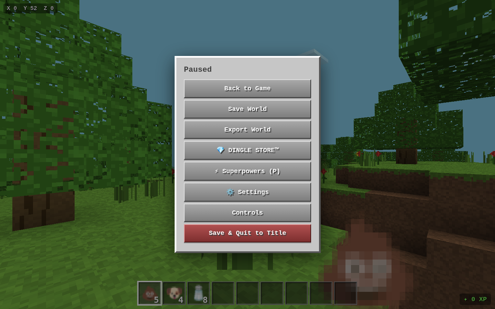

# DingleMod Launcher

A [Modrinth](https://modrinth.com)-inspired mod launcher and runtime modloader for
**[DINGLECRAFT](https://github.com/Cylinder7/dinglecraftMODS)** — the browser voxel
sandbox where you punch trees, ride dragons, and gamble away your savings at the casino.

Browse a mod catalog, install mods with one click, and hit **LAUNCH MODDED GAME** —
the launcher fetches the bundled game, injects the DingleMod loader, applies your
enabled mods, and opens a fully modded DINGLECRAFT in a new tab. No downloads, no
installers, everything runs in the browser.



## Features

- **Modrinth-style launcher UI** — browse, search, filter, one-click install, enable/disable toggles, mod detail pages with markdown descriptions and downloads.
- **Runtime modloader** — the `DingleMod` API is injected into the game at launch: items, spawn eggs, entities, sounds, recipes, tick hooks, inventory extensions and more.
- **11 official mods** in the catalog (see below).
- **Upload your own mods** — paste or upload a mod script on the Upload page and it joins the community catalog.
- **AI Forge** — generates a spec-perfect prompt you can paste into any external AI so it produces a DingleMod-compatible mod on the first try.
- **Bundled game** — DINGLECRAFT ships inside the launcher (`public/game/DINGLECRAFT.html`), so the site is fully self-contained.
- **In-game console** — press `/dm` in a modded game to open the DingleMod console.

## The official catalog

| Mod | What it does |
| --- | --- |
| **Throwable Poop** | Pick up poop, throw poop, spread the word. Poop Collector scorecard included. |
| **Clifford the Big Red Dog** | Clifford Spawn Egg + a giant red dog that follows you around. |
| **Dragon Airlines** | Ride dragons like an airline. Earn Frequent Flyer miles. |
| **Nuke Keg Pet** | Adopt Keggy, a keg that loves you unconditionally. |
| **Guilt Ghost BeGONE** | Banish guilt ghosts using Blessed Salt. |
| **Eternal Snail Racing** | Bet on the eternal snail race. The snail usually wins. |
| **Casino VIP Pass** | VIP room, golden tag, ads removed. VIP mood. |
| **Microtransactions That Work** | Microtransactions that actually work (this is a joke) (it works). |
| **Poop Rain** | Weather forecast: poop. |
| **Malgorath Pacifier** | Pacify Malgorath. |
| **Inventory Search & Tooltips** *(QOL)* | Search bar above the inventory + hover tooltips showing item names. |

## Run it locally

Requires Node 18+.

```bash
npm install --include=dev
cp .env.example .env          # local SQLite location
npx prisma generate
npx prisma db push            # creates the database
npm run dev                   # http://localhost:3000
```

The mod catalog seeds itself automatically on the first API request.

## Deploy to Render (free)

The repo includes a Render Blueprint (`render.yaml`):

1. Push this repo to GitHub.
2. [render.com](https://render.com) → **New +** → **Blueprint** → select the repo → **Apply**.
3. Done — the launcher deploys on the free plan.

Full guide, manual setup, and persistence notes: **[DEPLOY-RENDER.md](DEPLOY-RENDER.md)**.

> Free-tier note: uploaded community mods live in an ephemeral SQLite and reset on
> redeploy (the official catalog re-seeds itself automatically). Attach a Render
> Disk if you want uploads to persist.

## Making your own mod

Two ways:

1. **AI Forge** (in the site): answer a few questions, and it generates a complete
   prompt describing the exact DingleMod mod structure — paste it into any AI and
   it will produce a working mod.
2. **By hand**: open any official mod in the catalog to view its source. A mod is a
   single self-registering script that calls the `DingleMod` API (`DingleMod.item(...)`,
   `DingleMod.spawnEgg(...)`, `DingleMod.tick(...)`, ...) and is loaded at launch time.

Then upload it on the **Upload** page to share it.

## Tech stack

Next.js 16 · React 19 · Tailwind CSS 4 · shadcn/ui · Prisma + SQLite · zero game
files modified (the loader injects at runtime).

## Credits

- **DINGLECRAFT** — the game itself lives at
  [Cylinder7/dinglecraftMODS](https://github.com/Cylinder7/dinglecraftMODS).
- Launcher and modloader built for the DingleMod project.
